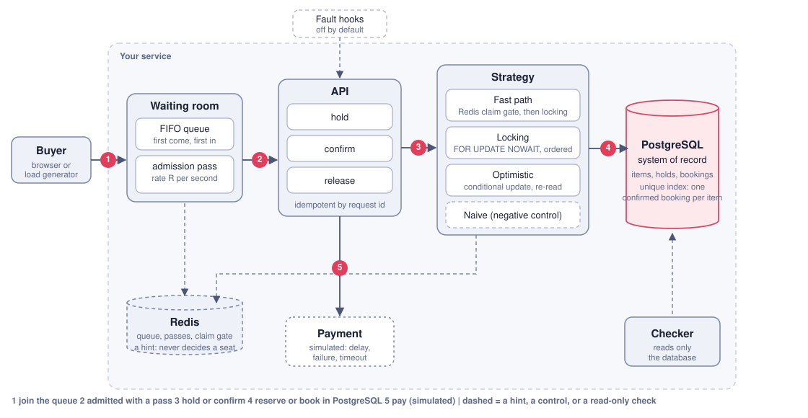
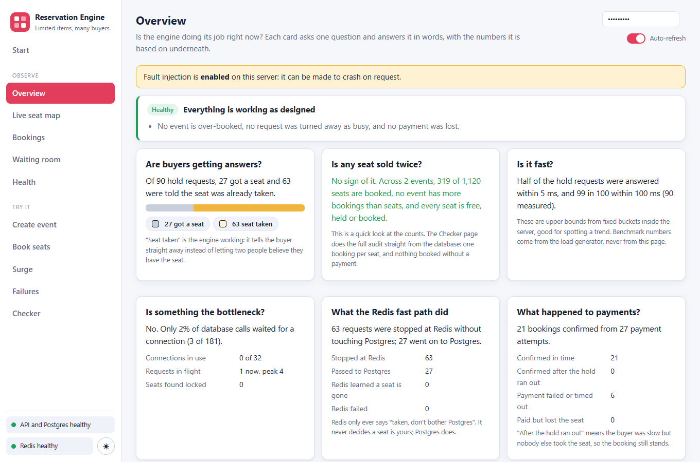
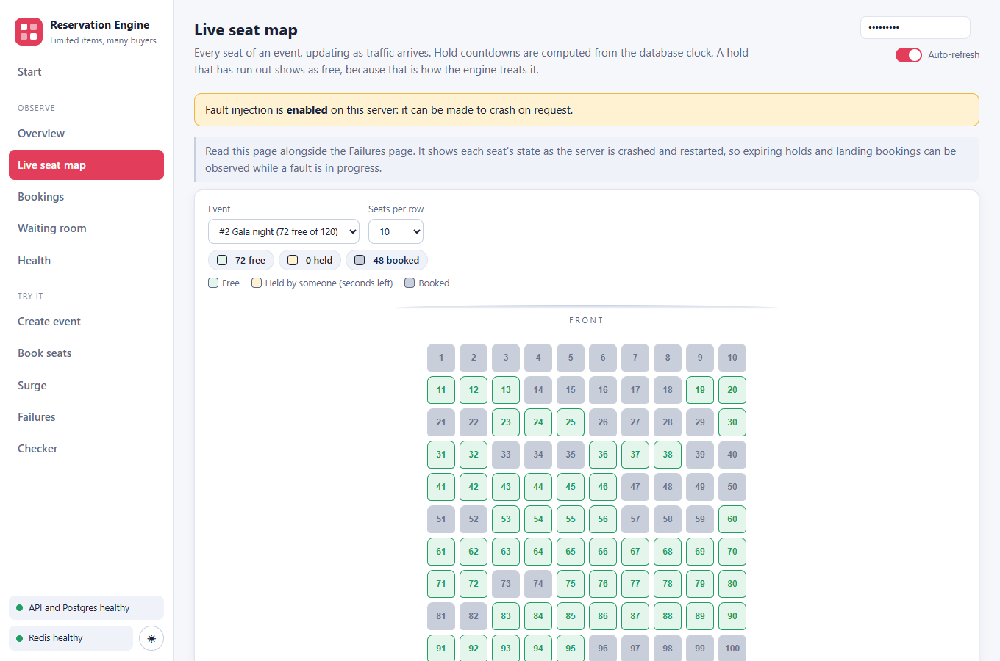
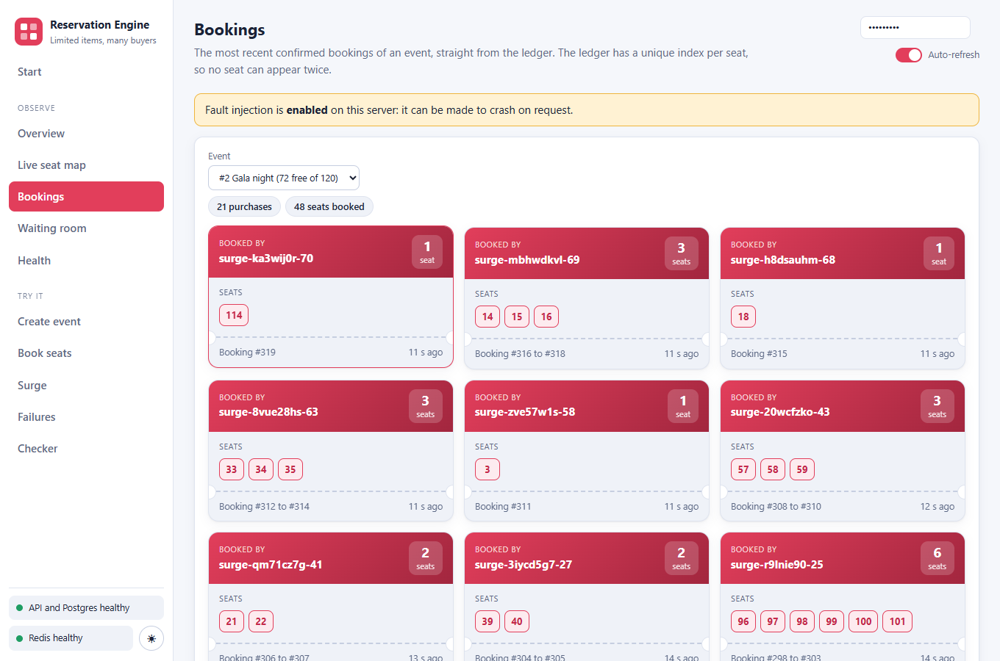
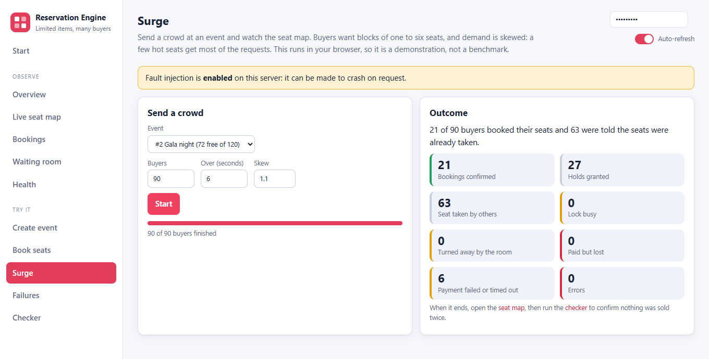
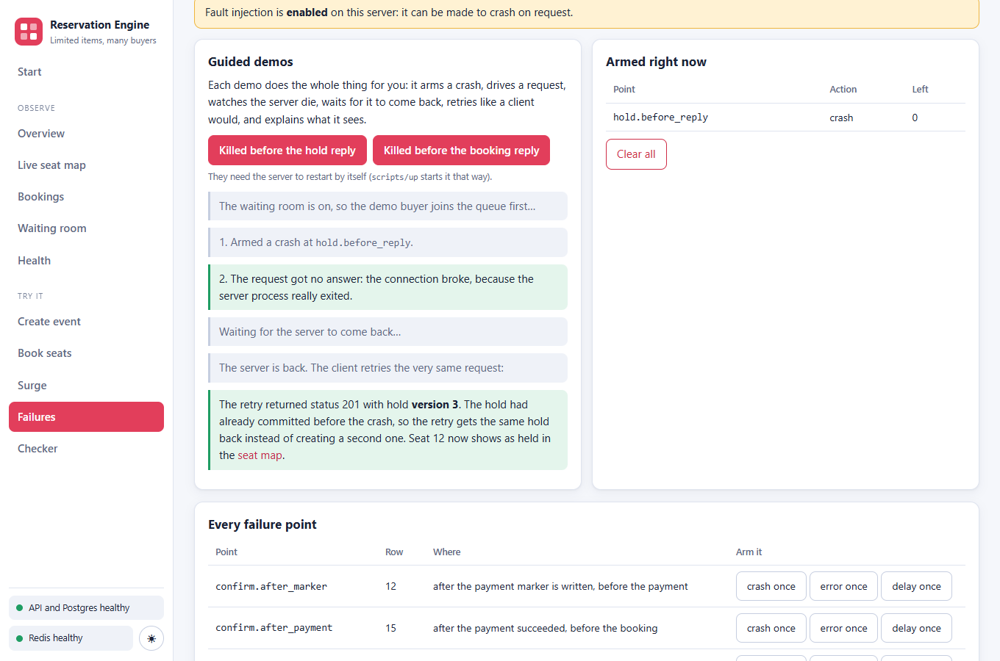
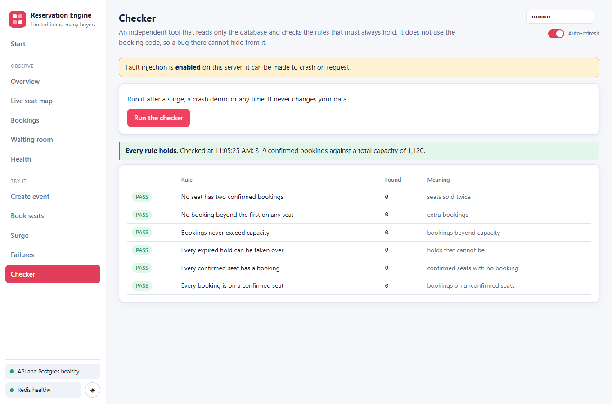

# Resource Reservation Engine

A reservation engine for scarce, numbered items (seats, tickets, slots) under heavy contention. Many buyers compete for few items at the same moment: the engine holds items for a short time, takes a (simulated) payment, and confirms, and it must **never sell an item twice**, even when a process is killed, the cache loses its state, or the database restarts. Four contention strategies are built and measured against each other, with a negative control that does fail, an independent correctness checker, real process kills, and a waiting room for surges.

<p align="center"></p>

1. A buyer joins the waiting room (optional) and is admitted at a fixed rate with a pass.
2. The buyer **holds** one to six items. The same request id always returns the same hold.
3. A strategy reserves them in **PostgreSQL**, the system of record: naive (the control), locking, optimistic, or a Redis fast path with the database still deciding.
4. The buyer pays (simulated) and **confirms**. A late confirm wins only if nobody took the item; a retried confirm never books twice.
5. A **unique index** on confirmed bookings makes a double sale impossible whatever the application, the cache or a crash does, and an **independent checker** verifies the final state from the database alone.

> **Scope: what is real and what is simulated.** The engine, the database, the cache, the load, the process kills (real `SIGKILL`s and real exits at named points) and the counting are real. **The payment is simulated** and **the demand is simulated**, and every measurement comes from **one cloud VM**. So every claim below holds "with a simulated payment and simulated demand, on one machine". See [docs/limitations.md](docs/limitations.md).

## What it demonstrates

- **A hard guarantee in the system of record.** A partial unique index (`UNIQUE (item_id) WHERE status = 'confirmed'`) means even buggy application code cannot record a second booking of one item.
- **Four strategies on one workload.** Naive check-then-update (the negative control), pessimistic locking (`FOR UPDATE NOWAIT`, ordered), optimistic conditional updates, and a Redis claim gate in front of locking that **fails open** and can lose all its state safely.
- **Safe by construction.** Expiry is lazy and uses the database clock (nothing can be stuck); every takeover bumps a fencing version; retries of hold, confirm and release are idempotent from the data, with no key table.
- **A waiting room for surges.** A Redis FIFO queue admits buyers at a global rate, protecting the database at the cost of queueing time.
- **Failure injection with real kills.** Named hooks that make the API exit at exact points, a supervisor, and store restarts under load, judged by the checker and a reconciler that handles requests of unknown outcome.
- **Measured, not claimed.** Open-loop load, a capacity protocol with confirmation runs and drift control, per-part CPU attribution, cores pinned and verified, every number traceable to a JSON record.
- **A console** that explains itself: a live seat map, booking, surge, failure controls with guided crash demos, and the checker.

## Results

All figures are from [docs/benchmarks.md](docs/benchmarks.md), taken on one 16-vCPU Linux VM, with a simulated payment and simulated demand.

| | Result |
|---|---|
| Correctness | Across **347 run records** of locking, optimistic and fast path (including real kills and store restarts): **0 double-sold items, 0 oversold, 0 stuck holds** |
| The checker can see a double sale | The naive strategy with no database protection **sold up to 86 seats of 10** (4 of 10 runs at high contention; once in 5 in the failure experiment). At 1,000 items it did not oversell, so the control needs contention to fire |
| The database alone is the guarantee | The naive code with only the unique index sold **no seat twice in 15 runs** (though it left other inconsistencies in 4 of 10 contention runs) |
| Failures under load | **75 API kills**, 15 Postgres restarts and 10 Redis restarts under load, 55 runs: all 50 runs of the protected strategies clean. Plus **55 real-kill crash tests**, all passed |

Confirmed capacity, in buyers per second, with the hold p99 under 1 s (p99 latency at 70% of it is 6 to 88 ms):

| Strategy | skew 0 | skew 0.8 | skew 1.1 | skew 1.4 |
|---|---|---|---|---|
| locking | 3,054 | 4,773 | 5,966 | **4,773** |
| optimistic | 3,054 | 4,773 | 9,323 | 18,210 |
| fast path | 3,054 | 4,773 | 11,654 | 18,210 |

With spread demand all three are identical; under hot-item contention **locking's capacity falls while optimistic and the fast path keep going**. In 11 of 12 cases the first thing to run out is the API's database connection pool (32), a configuration choice, not the hardware.

| Waiting room (a small database, locking) | Store p99 without the room | Store p99 with the room |
|---|---|---|
| 1.5x its capacity | 3,700 ms | 223 ms |
| 2x its capacity | 9,789 ms | 765 ms |

The queueing moves to the buyer (about 15 s at p99 at 2x), in order, with nobody turned away. It was measured up to 2x only. The numbers are explained, and every limit is stated, in [docs/benchmarks.md](docs/benchmarks.md) and [docs/limitations.md](docs/limitations.md).

## The console

The API serves a small console at its root. These screenshots come from a development run on a laptop (a 90-buyer surge, a few bookings by hand and a crash demo): they show the interface, **not benchmark numbers**, which are in [docs/benchmarks.md](docs/benchmarks.md).

**Overview.** Each card asks one plain question and answers it in words, with the numbers underneath.

<p align="center"></p>

**Live seat map** and **bookings**, grouped by purchase as tickets (the ledger keeps one row per seat; the console groups the seats bought in one request).

<p align="center"> </p>

**Surge.** Send a crowd at an event and watch the outcome fill in.

<p align="center"></p>

**Failures.** A guided demo arms a crash at a named point, drives a request, watches the server really exit, waits for it to come back, retries the very same request, and explains what it sees: the hold had already committed, so the retry gets the same hold back instead of creating a second one.

<p align="center"></p>

**Checker.** Reads only the database and verifies the rules that must always hold.

<p align="center"></p>

## Run it

```bash
scripts/up.sh        # or scripts\up.ps1: Postgres, Redis, the API with the console, a first event
# open http://localhost:8080   (the admin token for the Failures and Checker pages is printed)
scripts/down.sh      # close everything
scripts/test.sh      # vet and all tests (integration tests need `up`)
scripts/crash-tests.sh   # the real-kill scenarios
```

Requires Go 1.27 and Docker. The experiments (`scripts/bench-e1.sh` to `bench-e4.sh`), the benchmark-machine scripts and the settings are in [docs/deployment.md](docs/deployment.md).

## Documentation

| | |
|---|---|
| [docs/architecture.md](docs/architecture.md) | components, data model, the booking flow, the four strategies, the waiting room, configuration |
| [docs/design-decisions.md](docs/design-decisions.md) | each design choice (D1 to D15) and what it cost |
| [docs/crash-analysis.md](docs/crash-analysis.md) | what happens when each step fails, with the evidence for each |
| [docs/failure-scenarios.md](docs/failure-scenarios.md) | the failures walked through, and how to try them in the console |
| [docs/benchmarks.md](docs/benchmarks.md) | every measurement, the method, and what went wrong on the way |
| [docs/limitations.md](docs/limitations.md) | what the numbers do not show and what the engine does not handle |
| [docs/deployment.md](docs/deployment.md) | running it, the experiments, and the benchmark machine |
| `docs/data/` | the raw JSON record of every run (large per-run logs are not committed) |

## Repository layout

```text
cmd/            api (server), bench (experiments), loadgen, migrate
internal/       reservation/{naive,locking,optimistic,fastpath}, httpapi, waitingroom, payment,
                faults, checker, reconcile, loadgen, workload, bench, crashtest, db, ...
migrations/     core, backstop (the unique index), ops (fault settings)
web/            the console (embedded in the binary)
scripts/        up, down, test, bench-e1..e4, crash-tests, results-tables.py, vm/ (benchmark machine)
docs/           the documents above, images, data
```

About 7,900 lines of Go (non-test) and 168 test functions, including tests that kill the real binary.

## Status

Built and measured. Not done: a scaling run across several API instances, surge measurements above 2x, a real payment provider, and user authentication. These and the other limits are in [docs/limitations.md](docs/limitations.md).
