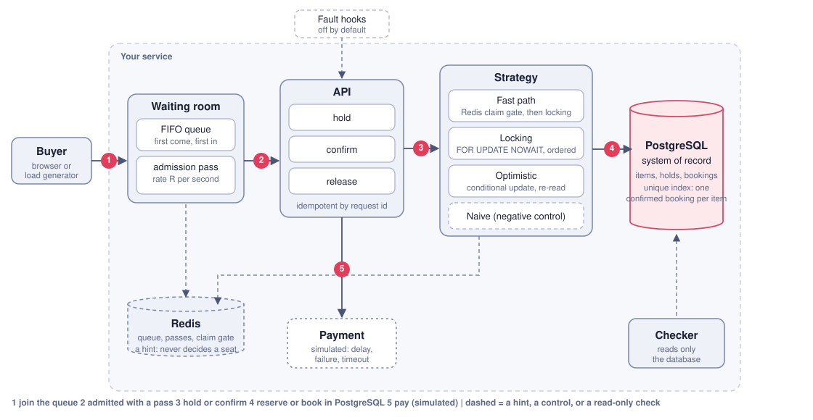

# Architecture

A buyer asks for one to six numbered items (seats). The engine holds them for a short time, takes a (simulated) payment, and confirms. Many buyers compete for few items, so the engine's job is to **never sell an item twice**, stay correct when a process or a store dies, and stay fast under contention. The reasons for each choice are in [design-decisions.md](design-decisions.md); what happens when each step fails is in [crash-analysis.md](crash-analysis.md).

## The one rule

**PostgreSQL is the system of record and the only arbiter.** A hold or a booking exists once its transaction commits. Redis (the waiting room and the fast-path gate) is a hint: it may be empty, stale or down, and correctness never depends on it. A partial unique index on the bookings ledger makes a second confirmed booking for the same item impossible whatever the application, the cache or a crash does.

## Components

| Component | Where | What it does |
|---|---|---|
| API server | `cmd/api`, `internal/httpapi` | The HTTP interface: events, availability, hold, confirm, release, the waiting room, metrics, the console, and the guarded admin controls |
| Strategies | `internal/reservation/{naive,locking,optimistic,fastpath}` | Four ways to reserve an item, behind one interface and one shared behaviour test suite (24 cases, mutation-checked) |
| Waiting room | `internal/waitingroom` | A Redis FIFO queue and admission passes, admitting buyers at a global rate |
| Payment | `internal/payment` | The simulated provider: a delay range, a failure rate and a timeout |
| Fault injection | `internal/faults` | Named hooks that crash, fail or delay the API at exact points; off by default |
| Checker | `internal/checker` | Verifies the final state from the database alone |
| Reconciler | `internal/reconcile` | Compares what clients were told with the database, handling unknown outcomes |
| Load generator | `internal/loadgen`, `cmd/loadgen` | An open-loop generator with skewed demand and the waiting-room flow |
| Benchmark runners | `cmd/bench`, `internal/bench` | E1 to E4, capacity protocol, environment capture, per-part CPU |
| Console | `web/` | A built-in page: live seat map, booking, surge, failure controls, checker |
| Migrations | `migrations/`, `cmd/migrate` | The schema, in three groups (core, backstop, ops) |

## Data model

| Table | Holds |
|---|---|
| `events` | an event and its capacity |
| `items` | one row per sellable item: `state` (free, held, confirmed), `hold_version` (a fencing counter bumped on every hold), `holder`, `hold_request_id`, `hold_expires_at`, `payment_started_at` |
| `bookings` | an append-only ledger: one row per confirmation with the buyer and the `hold_version` it was confirmed under |
| `fault_config` | one row per injection point (action, remaining count, probability) |

- **The backstop** is `CREATE UNIQUE INDEX ... ON bookings (item_id) WHERE status = 'confirmed'`. It lives in its own migration group and is absent from the **unprotected** schema that the negative control runs against (a separate Postgres schema, so the control can oversell and the checker can see it).
- **Expiry is lazy.** A hold stores `hold_expires_at`; an item is available if it is `free`, or `held` with an expiry in the past, judged on the **database clock**. Nothing sweeps expired holds, so no process can die and leave an item stuck, and clock differences between servers do not matter.
- **Every takeover bumps `hold_version`.** A stale holder's confirm or release carries an old version and is refused.

## The booking flow

1. **Join the waiting room** (optional, `ROOM_RATE` > 0): `POST /queue/join`, then poll `GET /queue/{buyer}`. The buyer is told queued (with a position), admitted (with a pass token) or retry (the queue is full).
2. **Hold:** `POST /holds` with `buyer_id`, a client-chosen `request_id` and one to six `item_ids`, plus the pass as `X-Admission-Token`. All items are held or none are. The same `request_id` returns the same hold, never a second one.
3. **Pay and confirm:** `POST /holds/confirm`. The server first writes a *payment marker* with a conditional update, so a concurrent retry gets "payment in progress"; the payment runs **outside any transaction**; then one transaction checks the hold version, appends the booking and marks the items confirmed. A failed or timed-out payment releases the hold.
4. **Release:** `POST /holds/release` frees a hold; it is a safe no-op if the hold is no longer the caller's.

| Call | Success | Other outcomes |
|---|---|---|
| `POST /holds` | 201 `held` | 409 `unavailable` (final, do not retry), 503 `lock_busy` (retry shortly), 403 `not_admitted` (join the queue) |
| `POST /holds/confirm` | 200 `confirmed` (`replayed` for a retry, `after_expiry` for a late confirm that still won) | 402 `payment_failed` or `payment_timeout`, 409 `hold_lost` (another buyer took the item), 409 `payment_in_progress` |
| `POST /holds/release` | 200 `released` or `not_held` | |
| `POST /queue/join`, `GET /queue/{buyer}` | 200 `queued` or `admitted` | 429 when the queue is full |

A late confirm **wins if nobody took the item** (a hold protects a buyer from contention; it does not punish a slow payment). If another buyer took it, the confirm is refused as `hold_lost`, and if the buyer had already paid it is counted as *paid but lost* (the payment is simulated, so nothing is refunded).

## The four strategies

All four implement one interface and pass one shared behaviour suite, so the comparison is between mechanisms, not between feature sets.

| Strategy | How it reserves | What it costs |
|---|---|---|
| **Naive** (the negative control) | Reads that the item is free, then updates it; no guard in the write | Races. On the unprotected schema it oversells; on the protected schema it fails with unique-violation errors instead |
| **Locking** (the default) | `SELECT ... FOR UPDATE NOWAIT` on the items in ascending id order, inside a short transaction. A busy row lock answers `lock_busy`; a taken item answers `unavailable`. Nobody ever waits on a lock, so lock cycles cannot form | Retry traffic on hot items; row locks hold a connection longer under skew |
| **Optimistic** | Conditional per-row updates on version and state. If fewer rows update than asked, roll back and re-read **once** to classify: taken (final) or a spurious conflict (retry). The server never loops; the retry bound lives in the client policy | Wasted work shows as retries and extra reads |
| **Fast path** | A Redis Lua script atomically claims every requested item or none; a Redis "no" rejects without touching the database, a "yes" only lets the request continue to locking, which still decides. Claims are two-phase (short pending lifetime, extended when Postgres accepts, removed when it refuses) and owner-checked; if Redis errors, requests **fail open** to Postgres | Extra code; a Redis restart sends load to the database; the gate can wrongly refuse a free item in narrow windows (counted), never cause a double sale |

## The waiting room

A Redis sorted set ordered by an atomic sequence number holds the queue. One atomic script admits buyers at a global rate R measured on Redis's own clock (a token bucket with a small burst), so adding API instances does not multiply the rate. Tickets of buyers who stop polling expire and are skipped, joining twice keeps the original place, and the queue is bounded. A queued buyer is told when to poll again (about when their turn comes, between 0.2 and 5 s). Admission is per buyer: a random pass with a time limit that `POST /holds` requires. If Redis is unreachable the room **fails open**. It guarantees first come, first in among buyers who keep polling and at most R admissions per second; it does not guarantee fairness for buyers who rejoin, protection against one person using many buyer ids, or that an admitted buyer gets an item.

## The checker and the reconciler

- **Checker** (`internal/checker`): reads only the database and verifies that no item has two confirmed bookings, confirmed bookings never exceed capacity, no hold is stuck (every expired hold can really be taken over), and no booking sits on an unconfirmed item. It does not use the booking code, so a bug there cannot hide from it. `GET /admin/check` runs it.
- **Reconciler** (`internal/reconcile`): compares what each client was told with the ledger, and handles a request of unknown outcome (the server was killed): the booking may or may not exist, and the database decides. It flags a confirmation the database does not have, and a booking nobody asked for.

## Fault injection

Each row of the crash analysis has a named hook (for example `confirm.after_payment`) that can make the process exit with status 137 and no cleanup, return an injected error or add a delay. Settings live in a Postgres table that every process polls; a one-shot fault is consumed by one atomic update, so it fires in exactly one process and not again after a restart. It is off unless `FAULTS_ENABLED=true`, its controls need the admin token, and the benchmark refuses to measure against a server with it on.

## The console

The API serves a small console at its root: a start page that explains the system, an overview that answers plain questions (is anything sold twice? is it fast? what is the bottleneck?), a live seat map, bookings grouped by purchase, the waiting room, health, booking and surge pages, the failure controls with guided crash demos, and the checker. It is for demonstration and understanding, not a production admin tool.

## Configuration

| Variable | Meaning | Default |
|---|---|---|
| `DATABASE_URL`, `REDIS_ADDR` | the stores | local development ports |
| `HTTP_ADDR` | listen address | `:8080` |
| `STRATEGY` | `locking`, `optimistic`, `fastpath` or `naive` | `locking` |
| `SCHEMA` | `protected` or `unprotected` (the control) | `protected` |
| `DB_POOL_SIZE` | the API's database connections | 32 |
| `HOLD_TTL` | hold duration | 300 s |
| `PAYMENT_PROFILE` | `fast` or `realistic`, overridable per setting | `fast` |
| `ROOM_RATE` | waiting-room admissions per second; 0 disables it | 0 |
| `ROOM_MAX_QUEUE`, `ROOM_PASS_TTL`, `ROOM_HEARTBEAT_TTL` | waiting-room tuning | 100,000; 5 min; 30 s |
| `FAULTS_ENABLED`, `ADMIN_TOKEN` | fault injection and its guard | off; none |
| `GATE_PREFIX`, `ROOM_PREFIX`, `GATE_PENDING_TTL` | Redis key prefixes and the claim lifetime | `rre:`, `rroom:`, 2 s |

## Code map

`cmd/api` (server), `cmd/bench` (experiments), `cmd/loadgen` (load tool), `cmd/migrate` (schema). `internal/reservation/*` (strategies and the shared behaviour suite), `internal/httpapi`, `internal/waitingroom`, `internal/payment`, `internal/faults`, `internal/checker`, `internal/reconcile`, `internal/loadgen`, `internal/workload` (the skewed picker), `internal/bench`, `internal/crashtest` (real-kill tests), `internal/db`, `web/` (the console, embedded in the binary).
